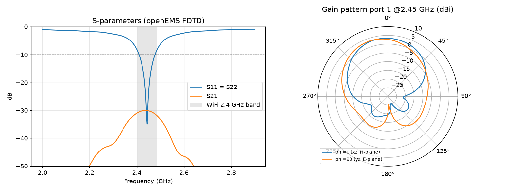

# 2.45 GHz 1×2 MIMO inset-fed patch antenna (FR-4, copper tape build)

Two inset-fed microstrip patches for 2.4 GHz WiFi MIMO on a 160 × 100 mm, 1.6 mm FR-4 board.
Simulated in openEMS (FDTD). The hand-built version uses adhesive copper tape cut with a 1:1 printed template.



## Geometry (mm)

| Parameter | Value |
|---|---|
| Substrate | FR-4, εr 4.4, tanδ 0.02, h = 1.6 |
| Board | 160 × 100, bottom = full ground |
| Patch W × L | 37.23 × 28.00 |
| Inset depth y0 | 8.50 |
| Inset notch gap g | 1.00 each side |
| 50 Ω feed width | 3.06 (runs to bottom board edge) |
| Element pitch | 80 centre-to-centre (0.65 λ0) |
| SMA (edge mount) | x = 40 and 120 from left edge |

Coordinates in `sim/mimo.py`: origin at the board centre, patch centres at x = ±40 and y = +10. Feeds run to y = −50.

## Simulated results (openEMS, 30 cells/λ in FR-4)

| Metric | Value |
|---|---|
| Resonance | 2.444 GHz, S11 = −35 dB, Zin ≈ 51.3 + j1.3 Ω |
| −10 dB bandwidth | 2.410–2.476 GHz (66 MHz) |
| Isolation S21 | ≤ −30 dB over 2.400–2.4835 GHz |
| ECC | 0.016 (far-field), 1.2e-5 (S-parameter, lossless approximation) |
| Directivity / rad. eff. / gain | 7.59 dBi / 38 % / 3.4 dBi per port |

On the mesh check, going from 20 to 30 cells/λ moved the resonance by +4 MHz.

**Limitation:** a patch on 1.6 mm FR-4 is about 2.7 % bandwidth. It cannot cover the full 83.5 MHz band, so the bottom channels sit at roughly −6 to −9 dB.

### Tuning sweep (20 cells/λ unless noted)

| L | y0 | f_res (GHz) | S11 min (dB) |
|---|---|---|---|
| 28.81 (analytic) | 9.0 | 2.376 | −37.8 |
| 28.00 | 9.0 | 2.438 | −26.5 |
| 27.90 | 9.0 | 2.446 | −25.1 |
| 27.85 | 8.8 | 2.450 | −29.4 |
| 27.85 | 8.5 | 2.452 (2.456 @30/λ) | −40.1 |
| **28.00** | **8.5** | **2.444 @30/λ** | **−35.0** |

Sensitivity: about −75 MHz per +1 mm of L. Use L to set frequency and y0 to set the match.

## Repository layout

```
sim/mimo.py        openEMS model: geometry, 2-port lumped ports, optional NF2FF
sim/post.py        S-params, bandwidth, ECC (far-field + S-param), plots -> docs/results.png
template/template.py                       generates the 1:1 A4 cutting template
template/MIMO_patch_2G45_template_A4_1to1.pdf
results/           final far-field run + tuning sweep JSONs (f, S11, S21, Zin, patterns)
docs/              result plot, template preview
```

## Running

You need openEMS with its Python bindings (CSXCAD + openEMS), built from https://github.com/thliebig/openEMS-Project with `--python`.

```bash
RES=30 python3 sim/mimo.py 28.0 37.23 8.5 ff   # ~2-3 min on 2 cores
python3 sim/post.py
python3 template/template.py
```

## Build notes (copper tape)

1. **Print the template at 100 % ("Actual size").** Check the 100 mm and 50 mm bars and the 40 × 20 mm box with a ruler.
2. **Ground:** lay strips along the 100 mm direction, parallel to the feeds. Overlap them 3–5 mm and solder every seam along its full length, because tape adhesive usually doesn't conduct.
3. **Top:** use one piece of 50 mm tape per element, so the patch and feed line have no seams.
4. **Cutting:** tape the sheet over the board, cut through paper and copper with a steel rule, then peel off the excess.
5. **SMA:** edge-mount, centre pin on the line end. Keep the solder fillet small.
6. **Tuning:** FR-4 εr varies from 4.2 to 4.7, and trimming L only raises f. If you're unsure of your FR-4, start at L = 28.3, measure, then trim.

## License

MIT, see [LICENSE](LICENSE).
